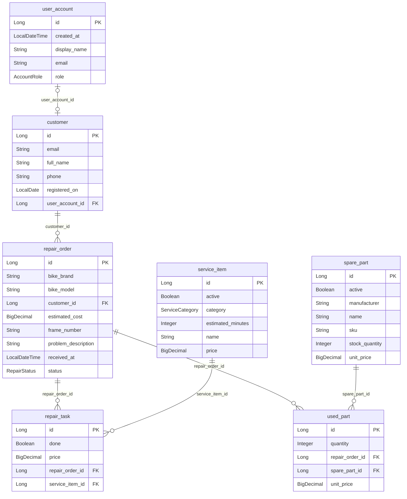

# Schemat bazy danych

Plik generują reguły projektu (panel Maven → Lifecycle → verify). Nie edytujcie go ręcznie.

Tabele: 7 · kolumny: 43 · relacje: 5 × @ManyToOne, 1 × @OneToMany, 1 × @OneToOne, 0 × @ManyToMany

| Tabela | Encja | Kolumny | Klucze obce |
|---|---|---|---|
| customer | Customer | 6 | user_account_id |
| repair_order | RepairOrder | 9 | customer_id |
| repair_task | RepairTask | 5 | repair_order_id, service_item_id |
| service_item | ServiceItem | 6 | — |
| spare_part | SparePart | 7 | — |
| used_part | UsedPart | 5 | repair_order_id, spare_part_id |
| user_account | UserAccount | 5 | — |

